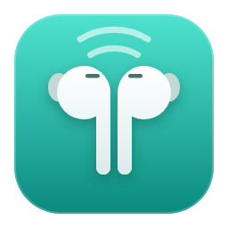

# 🎧 ClearPods

<p align="center">
  <a href="README.md">English</a> &bull;
  <a href="README_fr.md">Français</a>
</p>

<p align="center"></p>

> Use your AirPods microphone on Windows while keeping stereo sound. For Discord, games and calls, without switching all your audio to Hands-Free mode.

[](https://github.com/Yukouf/ClearPods/releases/latest)


[](LICENSE)

**[⬇️ Download ClearPods](https://github.com/Yukouf/ClearPods/releases/latest)**

---

## 🎯 The problem

You connect your AirPods, start a game and join Discord. As soon as the microphone turns on, **the sound becomes muffled and switches to mono**.

With the usual classic Bluetooth connection, Windows uses the **Hands-Free profile** to access the AirPods microphone. Game audio, music and voices all go through that call profile while the mic is open. Disabling Hands-Free restores stereo sound, but also removes access to the microphone through that profile.

---

## 💡 The solution

ClearPods receives the microphone audio through **Apple's accessory channel**, separately from stereo playback. Windows then sees a new input device: **"Headset (A2DP, your AirPods)"**. Select it in Discord, your game or your calling app.

The microphone stream is decoded locally. Optional noise suppression also runs on your PC.

## ✨ Features

| Feature | Detail |
|---|---|
| 🎧 **Stereo sound + microphone** | Keep stereo playback while using the AirPods microphone |
| 🎙️ **Local noise suppression** | Optional microphone processing on your PC |
| 🔋 **Microphone on demand** | The mic turns off when no application uses it |
| 🔄 **Both earbuds after a call** | The audio stream restarts after the mic stops, with a gap of about 0.4 seconds |
| 🎛️ **AirPods controls** | Battery, noise control, ear detection, conversation awareness and press-and-hold settings, depending on the model |
| 🪟 **Windows integration** | Tray icon, hotkeys, light and dark themes, 45 interface languages |
| 📦 **Optional updates** | Updates are opt-in |

---

## 📋 Requirements and compatibility

| Requirement | Detail |
|---|---|
| **System** | Windows 11, x64 |
| **Permissions** | Administrator rights for installation |
| **Bluetooth** | Built-in or USB adapter compatible with the adapter takeover |
| **Tested setup** | AirPods Pro + Intel Wi-Fi 6E AX211, USB ID `8087:0033` |

**Other AirPods and adapters have not yet been validated.** If you try a different setup, [report the result](https://github.com/Yukouf/ClearPods/issues/new/choose), including when everything works.

---

## 🚀 Installation

1. Download **`ClearPods-Setup.exe`** from the [latest release](https://github.com/Yukouf/ClearPods/releases/latest).
2. Run the installer and read the terms explaining the Bluetooth adapter takeover.
3. Open ClearPods, open your AirPods case near the PC and click **Connect**.
4. In ClearPods' **Windows settings**, enable **Disable Hands-Free mode**.
5. In Discord, your game or your calling app, select **"Headset (A2DP, your AirPods)"** as the input device.

**Uninstall:** Windows Settings → Apps → Installed apps → ClearPods → Uninstall. The adapter returns to Windows' own Bluetooth driver.

---

## ⚙️ How it works

ClearPods sits between Windows and the physical Bluetooth adapter:

1. A background service takes over the adapter with **WinUSB** and exposes a virtual adapter to Windows through [usbip-win2](https://github.com/vadimgrn/usbip-win2).
2. The service opens Apple's accessory channel, requests the microphone stream and decodes its **AAC-ELD** audio into a virtual microphone.
3. Hands-Free requests are suppressed so playback stays in stereo.
4. When the microphone stops, ClearPods suspends and restarts the audio stream so both earbuds keep playing.

Other Bluetooth devices use the virtual adapter exposed to Windows. Audio processing runs locally.

### Adapter recovery

The takeover is reversible. Uninstalling restores the Windows driver, and the service also restores it after **3 failed takeovers within 10 minutes**. ClearPods is provided without warranty; see the [license](LICENSE).

---

## 🆕 What's new in 1.0.0

- **Both earbuds keep playing after the microphone stops:** the audio stream is restarted to address playback remaining on only one earbud.
- **Updated interface:** light and dark themes, teal accent and a new icon.
- **Opt-in updates:** you choose whether to enable them.

---

## 🔧 Troubleshooting

| Problem | What to check |
|---|---|
| **Discord does not hear me** | Select "Headset (A2DP, your AirPods)" under Voice & Video → Input Device |
| **The microphone disappeared after reinstalling** | Select it again in the application: Windows assigns it a new device ID |
| **No sound after putting the AirPods back in** | Disconnect and reconnect the AirPods in Windows Bluetooth settings |
| **Audio takes time to become ready** | Try **Low audio latency** in ClearPods' Windows settings; it uses more battery |

Bluetooth still introduces latency. ClearPods does not promise a latency-free connection.

### Reporting a problem

[Open an issue](https://github.com/Yukouf/ClearPods/issues/new/choose) with your AirPods model, Bluetooth adapter, Windows version and the steps to reproduce the problem.

Logs are stored in:

- Service: `C:\ProgramData\ClearPods\logs`
- Application: `%LOCALAPPDATA%\ClearPods\logs`

Review the files before attaching them: they can contain device names and Bluetooth addresses. Pairing keys and audio are not logged.

---

## 📁 Project structure

```text
ClearPods/
├── src/
│   ├── ClearPods/           # Windows application, WebView2 and translations
│   └── ClearPods.Service/   # Bluetooth service and microphone handling
├── ui/                     # TypeScript web interface
├── native/                 # Native components, audio libraries and models
├── installer/              # Windows installer
├── docs/                   # Documentation assets
├── build.ps1               # Build and package the installer
├── README.md               # English documentation
└── README_fr.md            # French documentation
```

## 👤 Author and credits

**ClearPods: [Youssef Guerniou](https://github.com/Yukouf).**

Based on **[WPods](https://github.com/FPNDev/wpods) by fpndev**. Third-party components and their licenses are listed in [THIRD-PARTY-NOTICES.txt](THIRD-PARTY-NOTICES.txt).

## 📄 License

[GPL-3.0](LICENSE). Use, modify and redistribute under the terms of this license.

ClearPods is not affiliated with, sponsored or endorsed by Apple Inc. Apple, AirPods, AirPods Pro, AirPods Max, iPhone and Mac are trademarks of Apple Inc.
