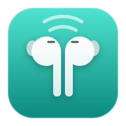

# 🎧 ClearPods

<p align="center">
  <a href="README.md">English</a> &bull;
  <a href="README_fr.md">Français</a>
</p>

<p align="center"></p>

> Utilisez le micro de vos AirPods sur Windows en gardant le son stéréo. Pour Discord, les jeux et les appels, sans faire basculer tout le son en mode mains libres.

[](https://github.com/Yukouf/ClearPods/releases/latest)


[](LICENSE)

**[⬇️ Télécharger ClearPods](https://github.com/Yukouf/ClearPods/releases/latest)**

---

## 🎯 Le problème résolu

Vous connectez vos AirPods, lancez un jeu et rejoignez Discord. Dès que le micro s'active, **le son devient étouffé et passe en mono**.

Avec une connexion Bluetooth classique habituelle, Windows utilise le **profil mains libres** pour accéder au micro des AirPods. Le son du jeu, la musique et les voix passent tous par ce profil d'appel tant que le micro est ouvert. Désactiver le mode mains libres rétablit la stéréo, mais supprime aussi l'accès au micro par ce profil.

---

## 💡 La solution

ClearPods récupère le son du micro par **le canal accessoire d'Apple**, séparément de la lecture stéréo. Windows voit alors un nouveau périphérique d'entrée : **« Headset (A2DP, vos AirPods) »**. Il suffit de le sélectionner dans Discord, votre jeu ou votre application d'appel.

Le flux du micro est décodé localement. La réduction de bruit optionnelle fonctionne elle aussi sur votre PC.

## ✨ Fonctionnalités

| Fonctionnalité | Détail |
|---|---|
| 🎧 **Son stéréo + microphone** | Gardez la lecture stéréo pendant que vous utilisez le micro des AirPods |
| 🎙️ **Réduction de bruit locale** | Traitement optionnel du micro sur votre PC |
| 🔋 **Micro à la demande** | Le micro s'éteint lorsqu'aucune application ne l'utilise |
| 🔄 **Deux écouteurs après un appel** | Le flux audio redémarre à l'arrêt du micro, avec une coupure d'environ 0,4 seconde |
| 🎛️ **Commandes des AirPods** | Batterie, contrôle du bruit, détection des oreilles, détection des conversations et appui long, selon le modèle |
| 🪟 **Intégration Windows** | Icône dans la zone de notification, raccourcis, thèmes clair et sombre, interface en 45 langues |
| 📦 **Mises à jour optionnelles** | L'activation des mises à jour reste votre choix |

---

## 📋 Prérequis et compatibilité

| Prérequis | Détail |
|---|---|
| **Système** | Windows 11, x64 |
| **Droits** | Administrateur pour l'installation |
| **Bluetooth** | Adaptateur intégré ou USB compatible avec la prise en charge par ClearPods |
| **Configuration testée** | AirPods Pro + Intel Wi-Fi 6E AX211, identifiant USB `8087:0033` |

**Les autres AirPods et adaptateurs n'ont pas encore été validés.** Si vous essayez une autre configuration, [partagez le résultat](https://github.com/Yukouf/ClearPods/issues/new/choose), même si tout fonctionne.

---

## 🚀 Installation

1. Téléchargez **`ClearPods-Setup.exe`** depuis la [dernière version](https://github.com/Yukouf/ClearPods/releases/latest).
2. Lancez l'installateur et lisez les conditions expliquant la prise en charge de l'adaptateur Bluetooth.
3. Ouvrez ClearPods, ouvrez le boîtier des AirPods près du PC et cliquez sur **Connecter**.
4. Dans les **paramètres Windows** de ClearPods, activez **Désactiver le mode Mains libres**.
5. Dans Discord, votre jeu ou votre application d'appel, sélectionnez **« Headset (A2DP, vos AirPods) »** comme périphérique d'entrée.

**Désinstallation :** Paramètres Windows → Applications → Applications installées → ClearPods → Désinstaller. L'adaptateur retrouve le pilote Bluetooth de Windows.

---

## ⚙️ Fonctionnement

ClearPods s'intercale entre Windows et l'adaptateur Bluetooth physique :

1. Un service en arrière-plan prend en charge l'adaptateur avec **WinUSB** et présente un adaptateur virtuel à Windows via [usbip-win2](https://github.com/vadimgrn/usbip-win2).
2. Le service ouvre le canal accessoire d'Apple, demande le flux du micro et décode son audio **AAC-ELD** vers un microphone virtuel.
3. Les demandes de passage en mode mains libres sont bloquées pour conserver la lecture stéréo.
4. Lorsque le micro s'arrête, ClearPods suspend puis redémarre le flux audio pour que les deux écouteurs continuent de fonctionner.

Les autres périphériques Bluetooth utilisent l'adaptateur virtuel présenté à Windows. Le traitement audio fonctionne localement.

### Restauration de l'adaptateur

La prise en charge est réversible. La désinstallation restaure le pilote Windows et le service le restaure également après **3 échecs de prise en charge en 10 minutes**. ClearPods est fourni sans garantie ; consultez la [licence](LICENSE).

---

## 🆕 Nouveautés de la version 1.0.0

- **Les deux écouteurs restent actifs après l'arrêt du micro :** le flux audio est relancé pour corriger la lecture qui restait sur un seul écouteur.
- **Interface revue :** thèmes clair et sombre, accent turquoise et nouvelle icône.
- **Mises à jour optionnelles :** vous choisissez de les activer ou non.

---

## 🔧 Dépannage

| Problème | Point à vérifier |
|---|---|
| **Discord ne capte pas ma voix** | Sélectionnez « Headset (A2DP, vos AirPods) » dans Voix & vidéo → Périphérique d'entrée |
| **Le micro a disparu après une réinstallation** | Sélectionnez-le à nouveau dans l'application : Windows lui attribue un nouvel identifiant |
| **Aucun son après avoir remis les AirPods** | Déconnectez puis reconnectez les AirPods dans les paramètres Bluetooth de Windows |
| **Le son met du temps à être disponible** | Essayez **Faible latence audio** dans les paramètres Windows de ClearPods ; cette option consomme davantage de batterie |

Le Bluetooth introduit toujours de la latence. ClearPods ne promet pas une connexion sans délai.

### Signaler un problème

[Ouvrez une issue](https://github.com/Yukouf/ClearPods/issues/new/choose) avec votre modèle d'AirPods, votre adaptateur Bluetooth, votre version de Windows et les étapes permettant de reproduire le problème.

Les journaux se trouvent dans :

- Service : `C:\ProgramData\ClearPods\logs`
- Application : `%LOCALAPPDATA%\ClearPods\logs`

Relisez les fichiers avant de les joindre : ils peuvent contenir des noms d'appareils et des adresses Bluetooth. Les clés d'appairage et le son ne sont pas enregistrés dans les journaux.

---

## 📁 Structure du projet

```text
ClearPods/
├── src/
│   ├── ClearPods/           # Application Windows, WebView2 et traductions
│   └── ClearPods.Service/   # Service Bluetooth et gestion du microphone
├── ui/                     # Interface web en TypeScript
├── native/                 # Composants natifs, bibliothèques audio et modèles
├── installer/              # Installateur Windows
├── docs/                   # Ressources de la documentation
├── build.ps1               # Compilation et création de l'installateur
├── README.md               # Documentation anglaise
└── README_fr.md            # Documentation française
```

## 👤 Auteur et crédits

**ClearPods : [Youssef Guerniou](https://github.com/Yukouf).**

Basé sur **[WPods](https://github.com/FPNDev/wpods) de fpndev**. Les composants tiers et leurs licences sont détaillés dans [THIRD-PARTY-NOTICES.txt](THIRD-PARTY-NOTICES.txt).

## 📄 Licence

[GPL-3.0](LICENSE). Utilisation, modification et redistribution selon les conditions de cette licence.

ClearPods n'est ni affilié, ni sponsorisé, ni approuvé par Apple Inc. Apple, AirPods, AirPods Pro, AirPods Max, iPhone et Mac sont des marques d'Apple Inc.
